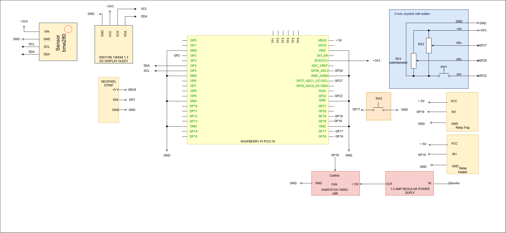
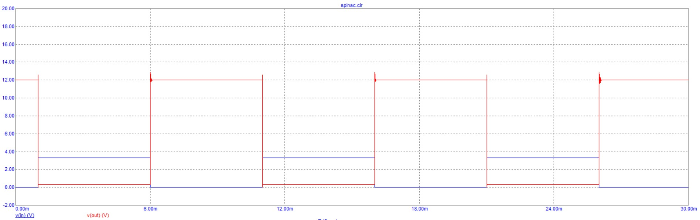
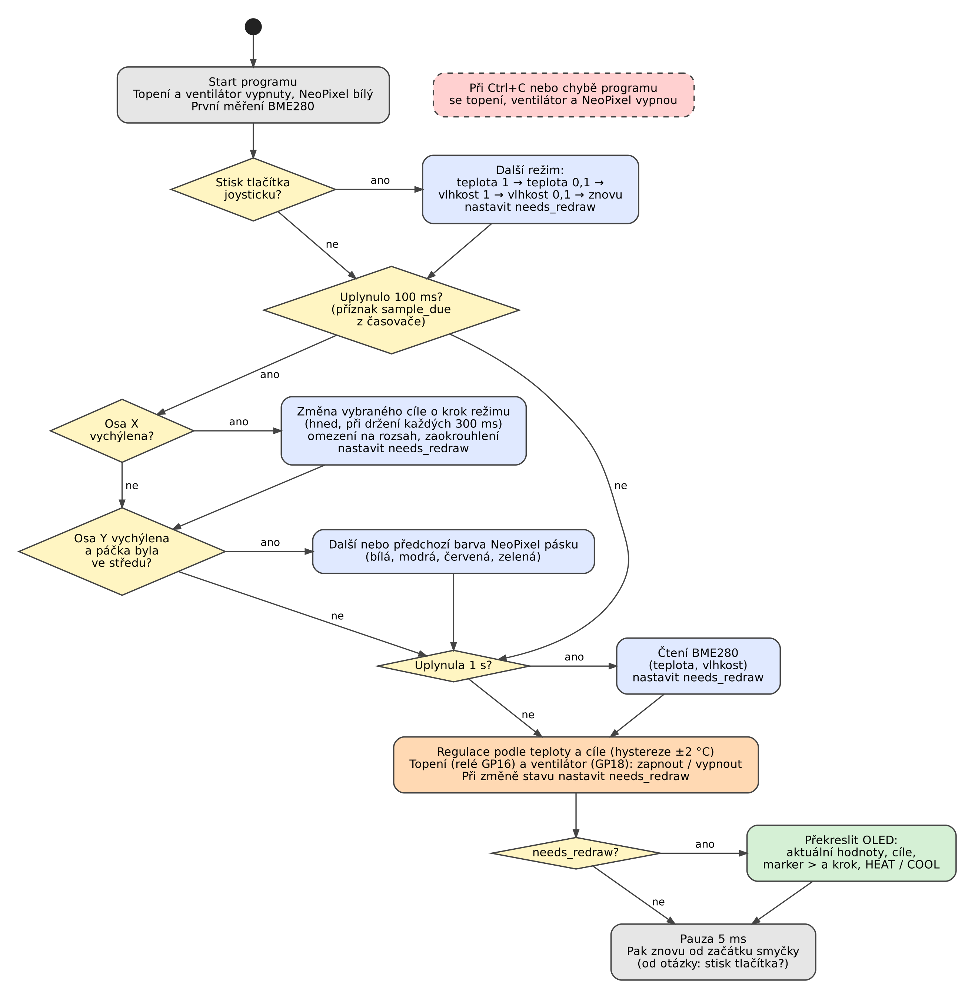

# Chytrý skleník

### Členové týmu
* Vítek Borovka
* Václav Javůrek
* Jakub Kotačka

---

## Základní vize projektu
Měření vlhkosti a teploty pomocí BME280

Zobrazování dat na OLED a pomocí WiFi připojení na server

Nastavování práhů pro teplotu a vlhkost pomocí joysticku

RGB LED k indikaci aktuálních funkcí

Ovládání větráku

Simulace topného tělesa pomocí relé 

## Seznam hardwarových komponentů

| Komponenta | Účel v projektu | Odkaz |
| :--- | :--- | :--- |
| **Raspberry Pi Pico W** | Řídicí mikrokontroler s WiFi | [Stránka součástky](https://pip-assets.raspberrypi.com/categories/686-raspberry-pi-pico-w/documents/RP-008312-DS-2-pico-w-datasheet.pdf) |
| **BME280** | Senzor teploty a vlhkosti (I2C) | [Stránka součást](https://www.alldatasheet.com/datasheet-pdf/pdf/1132060/BOSCH/BME280.html) |
| **OLED displej** | Zobrazování naměřených a cílových hodnot | [Stránka součástky](https://dratek.cz/arduino-platforma/1978-0-96-i2c-oled-displej-0-96-128x64-zluty-modry.html?gad_source=1&gad_campaignid=17190055571&gbraid=0AAAAACVG_WcN12zaul8H1it_VvzY82czx&gclid=CjwKCAiAzp_YBhAJEiwASf8kHaf8aFN_GnqUJwFkXEIVuhzIZ_ozv6-NrM1MG3Is2BUpLwQ1A7_laxoCnTMQAvD_BwE) |
| **Joystick** | Nastavování prahových hodnot a barev | [Stránka součástky](https://manuals.plus/ae/1005005073051206) |
| **Ventilátor (12 V)** | Ochlazování / odvětrávání skleníku | [Stránka součástky](https://www.sunonusa.com/wp-content/uploads/2026/05/HA60151V4-1000U-A99-D06092600G-01-0-REF.pdf) |
| **NeoPixel Strip** | RGB LED indikace stavu | [Stránka součástky](https://www.laskakit.cz/en/led-pasek-neopixel-ws2812b-60led-m-ip30-5m-bily/?utm_source=google&utm_medium=cpc&utm_campaign=1_PMax_%5BCZ%5D_Top_tROAS_550&utm_id=18587021915&gad_source=1&gad_campaignid=21607691975&gbraid=0AAAAADPjitK7LgKpbm1zIEF-jsz7oPR4J&gclid=CjwKCAiAzp_YBhAJEiwASf8kHVnY1mypuouzHotWObc_o4AugHZN1VRcyJmDu7zR0r7AVb-Zt7iruhoC6xsQAvD_BwE#relatedFiles) |
| **Relé modul** | Spínání topného tělesa | [Stránka součástky](https://www.alldatasheet.com/datasheet-pdf/pdf/45765/SIEMENS/SRD00111Z.html) |
| **Zdroj 12 V** | Napájení ventilátoru / výkonové části | [Stránka součástky](SEM_VLOZ_ODKAZ) |
| **Tranzistor 2N7000** | N-MOSFET pro spínání ventilátoru | [Datasheet](https://datasheet4u.com/download/1134507/2N7000.html) |
| **Dioda 1N4148** | Ochranná antiparalelní dioda k ventilátoru | [Stránka součástky](https://www.alldatasheet.com/html-pdf/15021/PHILIPS/1N4148/245/1/1N4148.html) |

## Zapojení
### Blokové schéma

### Realizace spínání ventilátoru

Pro spínání ventilátoru byl využit N-MOSFET tranzistor 2N7000. Z datasheetu lze vyčíst maximální Ugs th = 3V, takže v případě přivedení log.1 (3.3V) na Gate dojde tak k dostatečnému otevření a sepnutí tranzistoru.

Pull-down rezistor R1 (5kΩ) zajišťuje uzemnění při prvotním startu zařízení a zabraňuje tak nechtěnému sepnutí tranzistoru.

Rezistor R2 (218Ω) omezuje proud kapacity hradla a chrání tak pin mikrokontroleru před proudovými špičkami.

Jako náhradní schéma ventilátoru pro simulaci byla použita sériová kombinace indukčnosti a rezistoru, které představují jeho reálné vlastnosti.

Antiparalelně k ventilátoru byla zapojeno dioda 1N4148. Tato dioda slouží k ochraně tranzistoru, neboť při vypínání dochází na cívce k uvolnění akumulované energie a vzniku napěťových špiček, které by mohly tranzistor poškodit. Dioda slouží k vybití toho proudu viz. simulace.

Bez diody

S diodou

## Software

Logika programu

Program běží v jedné hlavní smyčce, která se opakuje přibližně každých 5 ms. V každém průchodu zkontroluje tlačítko joysticku, a pokud je na řadě, přečte joystick a senzor, rozhodne o zapnutí topení a ventilátoru a podle potřeby překreslí displej. Čtení joysticku řídí časovač, který se spouští každých 100 ms. Obsluha přerušení od časovače ale musí být co nejkratší, proto pouze nastaví příznak `sample_due`. Skutečnou práci pak udělá hlavní smyčka, jakmile příznak uvidí. Senzor BME280 se čte jednou za sekundu podle měření času pomocí `ticks_ms`, protože teplota ani vlhkost se nemění rychleji a častější čtení by jen zdržovalo smyčku.

Displej se nepřekresluje v každém průchodu, ale jen když se něco změnilo. K tomu slouží příznak `needs_redraw`, který se nastaví při stisku tlačítka, změně cílové hodnoty, novém měření nebo zapnutí či vypnutí topení a ventilátoru. Přenos celé obrazovky po I2C je totiž pomalý, a když se displej překresloval pořád, smyčka byla většinu času zaneprázdněná a program přehlížel stisky tlačítka. Pomohlo také zvýšení rychlosti I2C ze 100 kHz na 400 kHz, kdy je překreslení asi čtyřikrát rychlejší.
Joystick se ovládá takto. Tlačítko přepíná čtyři režimy: teplota s krokem 1, teplota s krokem 0,1, vlhkost s krokem 1 a vlhkost s krokem 0,1. Osa X mění cílovou hodnotu vybraného režimu. Při vychýlení se hodnota změní hned, a pokud držíme páčku, pak znovu každých 300 ms, takže se hodnoty dají nastavovat přesně a nerostou příliš rychle. Hodnota se vždy omezí na povolený rozsah a zaokrouhlí na jedno desetinné místo, aby se nenasčítaly chyby desetinných čísel. Hodnoty z ADC se navíc průměrují z osmi čtení, aby šum nezpůsobil falešné pohyby.

Osa Y mění barvu NeoPixel pásku. Pohyb nahoru nebo dolů přepne na další nebo předchozí barvu (bílá, modrá, červená, zelená) a po poslední barvě následuje zase první. Jedno vychýlení způsobí jednu změnu, před další změnou se musí páčka vrátit do středu, jinak by barvy při držení rychle „protáčely“.

Verze programu

Verze bez WiFi (`main_no_wifi.py`) funguje samostatně bez sítě. Teplotu a vlhkost měří BME280 a zobrazuje je na OLED displeji, cílové hodnoty se nastavují joystickem (tlačítko přepíná mezi teplotou a vlhkostí s krokem 1 nebo 0,1, osa Y mění barvu NeoPixel pásku). Relé topení se zapne, když teplota klesne o 2 °C pod cílovou hodnotu, a vypne se o 2 °C nad ní, ventilátor pracuje zrcadlově. Program se spustí okamžitě a nepotřebuje žádné další soubory.

Verze LAN only (`main_wifi_LAN_Only.py`) má všechny funkce předchozí verze a navíc se po startu připojí k WiFi a spustí webový server. IP adresa se na 3 sekundy zobrazí na OLED displeji a v prohlížeči na zařízení ve stejné síti se pak ukáže aktuální teplota, vlhkost, stav topení a ventilátoru a formulář pro nastavení cílových hodnot. Joystick i webová stránka mění stejné hodnoty. Stránka je dostupná pouze v místní síti (LAN) a nemá heslo. Pokud se WiFi nepřipojí, program běží dál jen s joystickem. Navíc potřebuje soubory `wifi_utils.py` a `config.py`.Každých 30 sekund posíla program data (teplotu,vlhksot,a stav ventilátoru/topného tělesa) na cloud na stránku ThingSpeaku [**https://thingspeak.mathworks.com/channels/3585859/sharing**](https://thingspeak.mathworks.com/channels/3585859)

## Zdroje
2N7000 datasheet - https://datasheet4u.com/download/1134507/2N7000.html

