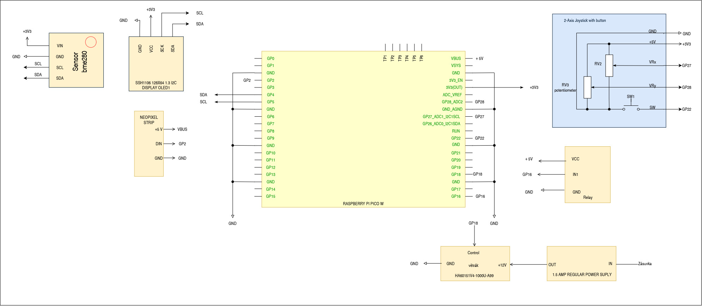
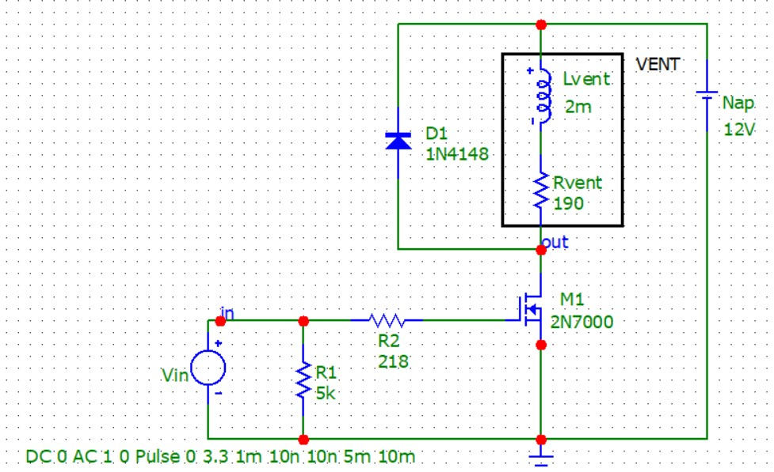

# SMART_GREENHOUSE_MONITOR

### Členové týmu
* Vítek Borovka
* Václav Javůrek
* Jakub Kotačka

---

## Základní vize projektu
Měření vlhkosti a teploty pomocí BME280

Zobrazování dat na OLED a pomocí WiFi připojení na server

Nastavování práhů pro teplotu a vlhkost pomocí joysticku

RGB LED k indikaci aktuálních funkcí

Ovládání větráku

Simulace topného tělesa pomocí LED

## Seznam hardwarových komponentů

### BME280
### Raspberry Pi Pico W1
### OLED displej
### Ventilátor
### NEOPIXEL STRIP
### Relé
### Zdroj 12V

## Zapojení
### Blokové schéma

### 
### Schéma zapojení v nepájivém poli

### Spínání ventilátoru

https://github.com/262721/Smart-greenhouse-monitor/blob/main/spinac_sim_dioda.jpg

## Software
### Cíl
### Postup vývoje

## Zdroje

