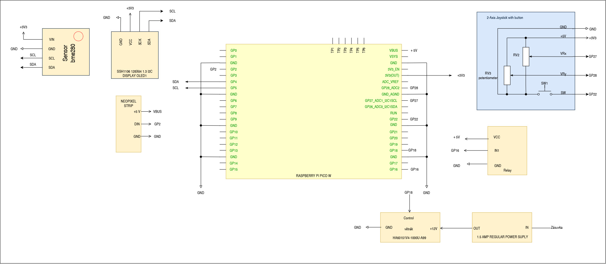
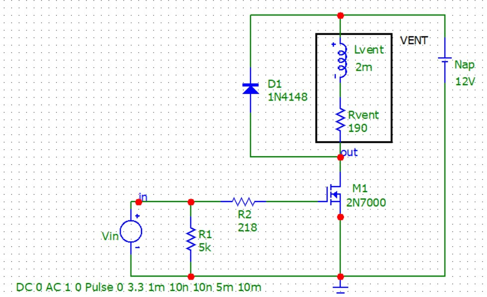
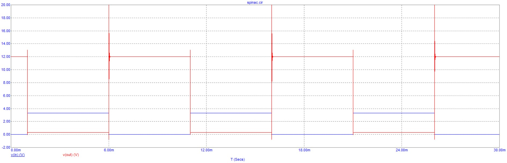

# SMART_GREENHOUSE_MONITOR

### Členové týmu
* Vítek Borovka
* Václav Javůrek
* Jakub Kotačka

---

## Základní vize projektu
Měření vlhkosti a teploty pomocí BME280

Zobrazování dat na OLED a pomocí WiFi připojení na server

Nastavování práhů pro teplotu a vlhkost pomocí joysticku

RGB LED k indikaci aktuálních funkcí

Ovládání větráku

Simulace topného tělesa pomocí relé 

## Seznam hardwarových komponentů

### BME280
### Raspberry Pi Pico W1
### OLED displej
### Ventilátor
### NEOPIXEL STRIP
### Relé
### Zdroj 12V

## Zapojení
### Blokové schéma

### 
### Schéma zapojení v nepájivém poli

### Spínání ventilátoru

Pro spínání ventilátoru byl využit N-MOSFET tranzistor 2N7000. Z datasheetu lze vyčíst maximální Ugs th = 3V, takže v případě přivedení log.1 (3.3V) na Gate dojde tak k dostatečnému otevření a sepnutí tranzistoru.

Pull-down rezistor R1 (5kΩ) zajišťuje uzemnění při prvotním startu zařízení a zabraňuje tak nechtěnému sepnutí tranzistoru.

Rezistor R2 (218Ω) omezuje proud kapacity hradla a chrání tak pin mikrokontroleru před proudovými špičkami.

Jako náhradní schéma ventilátoru pro simulaci byla použita sériová kombinace indukčnosti a rezistoru, které představují jeho reálné vlastnosti.

Antiparalelně k ventilátoru byla zapojeno dioda 1N4148. Tato dioda slouží k ochraně tranzistoru, neboť při vypínání dochází na cívce k uvolnění akumulované energie a vzniku napěťových špiček, které by mohly tranzistor poškodit. Dioda slouží k vybití toho proudu viz. simulace.

S diodou

Bez diody

Software: verze programu

Verze bez WiFi (`main_no_wifi.py`) funguje samostatně bez sítě. Teplotu a vlhkost měří BME280 a zobrazuje je na OLED displeji, cílové hodnoty se nastavují joystickem (tlačítko přepíná mezi teplotou a vlhkostí s krokem 1 nebo 0,1, osa Y mění barvu NeoPixel pásku). Relé topení se zapne, když teplota klesne o 2 °C pod cílovou hodnotu, a vypne se o 2 °C nad ní, ventilátor pracuje zrcadlově. Program se spustí okamžitě a nepotřebuje žádné další soubory.

Verze LAN only (`main_wifi_LAN_Only.py`) má všechny funkce předchozí verze a navíc se po startu připojí k WiFi a spustí webový server. IP adresa se na 3 sekundy zobrazí na OLED displeji a v prohlížeči na zařízení ve stejné síti se pak ukáže aktuální teplota, vlhkost, stav topení a ventilátoru a formulář pro nastavení cílových hodnot. Joystick i webová stránka mění stejné hodnoty. Stránka je dostupná pouze v místní síti (LAN) a nemá heslo. Pokud se WiFi nepřipojí, program běží dál jen s joystickem. Navíc potřebuje soubory `wifi_utils.py` a `config.py`.

## Zdroje
2N7000 datasheet - https://datasheet4u.com/download/1134507/2N7000.html

